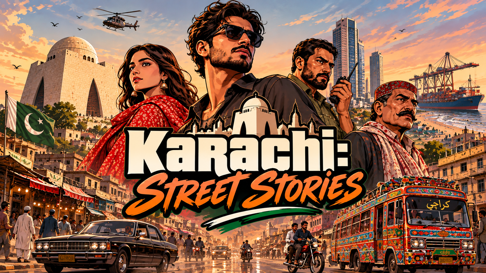
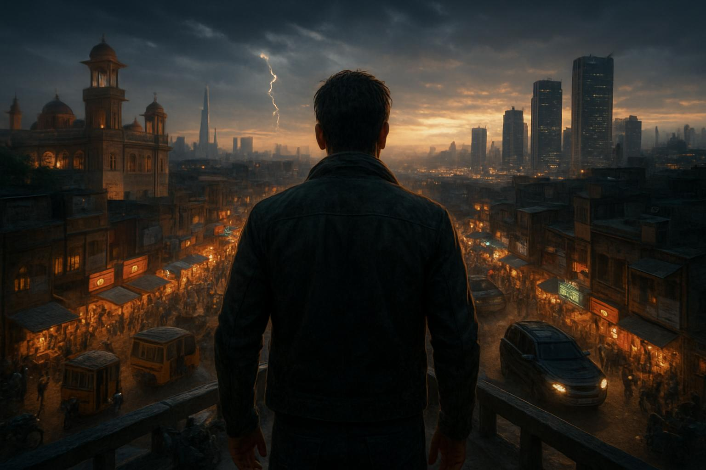
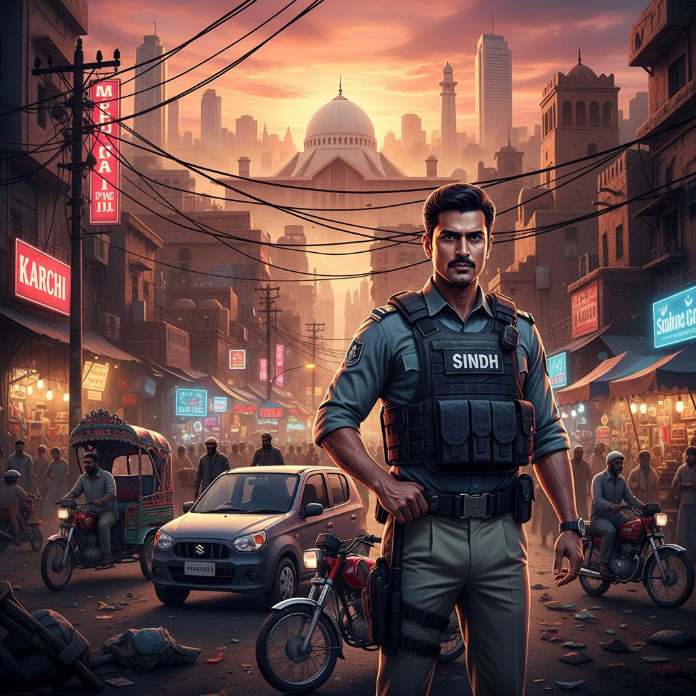
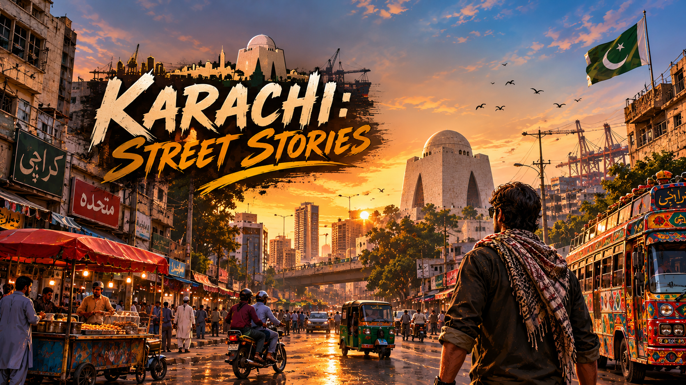

 

# KARACHI: STREET STORIES

### THE CITY IS YOURS. THE STORY IS YOURS.

`OPEN WORLD` &nbsp; `ACTION ADVENTURE` &nbsp; `PAKISTAN`

 

 

[PROJECT OVERVIEW](#project-overview) ·
[GAME WORLD](#game-world) ·
[FEATURES](#gameplay-experience) ·
[ROADMAP](#development-roadmap)

---

# 01 / PROJECT OVERVIEW

**A CITY. MILLIONS OF STORIES. ONE OPEN WORLD.**

Karachi: Street Stories is an ambitious open-world action-adventure game concept inspired by the culture, architecture, streets, people, and atmosphere of Karachi, Pakistan.

The project aims to build an immersive digital representation of Karachi, combining cinematic storytelling, urban exploration, vehicle gameplay, and authentic Pakistani environments.

The vision is to create a city that feels alive.

---

# 02 / CINEMATIC GAME GALLERY

**01 — OFFICIAL GAME IDENTITY**

  

**02 — THE STREETS OF KARACHI**

  

**03 — URBAN WORLD DESIGN**

  

**04 — A CITY FULL OF STORIES**

---

# 03 / THE GAME WORLD

### A DIGITAL RECREATION OF KARACHI

The proposed world draws inspiration from Karachi's distinctive environments.

  
| Location | World direction |
|---|---|
| Mazar-e-Quaid | Iconic city landmark |
| Saddar | Commercial urban district |
| Clifton | Coastal environment |
| Karachi Port | Industrial waterfront |
| Lyari | Dense neighborhood environment |
| Burns Road | Traditional food culture |
| Shahrah-e-Faisal | Major urban road network |

---

# 04 / GAMEPLAY EXPERIENCE

### BUILT FOR IMMERSION

| SYSTEM | DESIGN DIRECTION |
|---|---|
| Open World | Connected urban environments |
| Vehicles | Cars, motorcycles, buses and rickshaws |
| Characters | Original characters and storylines |
| Missions | Main missions and side activities |
| Traffic | Dynamic urban traffic simulation |
| Environment | Day/night and weather systems |
| Audio | Authentic Karachi soundscape |
| Exploration | Landmarks, markets and hidden locations |

*These are planned design directions, not claims of implemented functionality.*

---

# 05 / PAKISTANI CULTURAL IDENTITY

The game aims to represent Pakistan through authentic environmental details.

- Pakistani truck and bus art
- Urdu typography and local signage
- Traditional markets and food streets
- Pakistani architecture
- Local clothing and character design
- Regional music and soundscapes
- Karachi's coastline and urban lifestyle

---

# 06 / TECHNICAL VISION

### NEXT-GENERATION DEVELOPMENT DIRECTION

The technical architecture will be documented as the actual engine and technology stack are established.

  
| Layer | Planned direction |
|---|---|
| World Engine | Large-scale environment management |
| Rendering | Cinematic lighting and visual effects |
| AI | Pedestrian and traffic behaviors |
| Physics | Vehicle and environmental interactions |
| Audio | Spatial environmental sound |
| Data | Reproducible world and content datasets |
| Optimization | Performance and memory management |

---

# 07 / DEVELOPMENT ROADMAP

### FROM CONCEPT TO OPEN WORLD

| Phase | Milestone | Status |
|---|---|---|
| 01 | Project foundation | In progress |
| 02 | Canonical world dataset | In development |
| 03 | Environment prototype | Planned |
| 04 | Player and vehicle systems | Planned |
| 05 | Mission framework | Planned |
| 06 | World simulation | Planned |
| 07 | Optimization and testing | Planned |

---

# CONTRIBUTORS

### THE PEOPLE BEHIND THE WORLD

A project built through creativity, engineering, research, and collaboration.

 

<table>
  <tr>
    <td align="center" width="220">
      
       
      <h3>Abdul Hannan Kashif</h3>
      <strong>FOUNDER & PROJECT LEAD</strong>
       
      Vision · Direction · Development
    </td>
    <td align="center" width="220">
      
       
      <h3>Open Position</h3>
      <strong>GAME DEVELOPER</strong>
       
      Gameplay · Systems · Programming
    </td>
    <td align="center" width="220">
      
       
      <h3>Open Position</h3>
      <strong>3D ARTIST</strong>
       
      Characters · Vehicles · Environments
    </td>
  </tr>
</table>

 

<table>
  <tr>
    <td align="center" width="220">
      
       
      <h3>Open Position</h3>
      <strong>UI/UX DESIGNER</strong>
       
      Interface · User Experience
    </td>
    <td align="center" width="220">
      
       
      <h3>Open Position</h3>
      <strong>WORLD RESEARCHER</strong>
       
      Karachi · Culture · Architecture
    </td>
    <td align="center" width="220">
      
       
      <h3>Open Position</h3>
      <strong>AUDIO DESIGNER</strong>
       
      Soundscapes · Music · Effects
    </td>
  </tr>
</table>

 

Contributor profiles will be added as people officially join the project.

---

# WANT TO HELP BUILD KARACHI?

### YOUR SKILLS CAN BECOME PART OF THIS WORLD.

Whether you are a developer, artist, designer, writer, researcher, tester,
or someone with a strong idea, you can contribute to Karachi: Street Stories.

## HOW YOU CAN HELP

  
| Department | Contribution Opportunities |
|---|---|
| Programming | Gameplay mechanics, AI, systems, optimization |
| 3D Modelling | Karachi buildings, vehicles, characters, props |
| Environment Art | Streets, markets, interiors, landmarks |
| UI/UX Design | Menus, HUD, maps, interaction systems |
| Research | Karachi locations, culture, architecture |
| Story Writing | Missions, dialogue, characters, narratives |
| Sound Design | Traffic, markets, ambience, sound effects |
| Testing | Bug reports, gameplay feedback, performance testing |

---

## CONTACT & COLLABORATION

### HAVE AN IDEA? WANT TO CONTRIBUTE?

We are open to collaboration, technical support, creative contributions,
development discussions, and project suggestions.

 

## EMAIL CONTACT

&nbsp;

**GITHUB REPOSITORY**

**CONTRIBUTE TO THE PROJECT**

### WHEN CONTACTING US

Please include:

1. Your name and professional or technical background.
2. The department you want to contribute to.
3. Your relevant skills and experience.
4. Your portfolio, GitHub profile, or sample work (if available).
5. How you would like to support the project.

---

# KARACHI: STREET STORIES

`INDEPENDENT DEVELOPMENT` · `KARACHI, PAKISTAN` · `OPEN TO COLLABORATION`

**Every street has a story. Help us bring it to life.**

